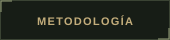
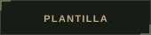
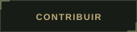
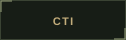
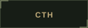
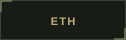
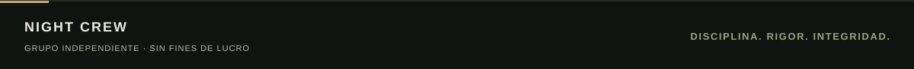

 

 

**Formación y ejercicios técnicos. Conocimiento al servicio de la seguridad digital.**

 

## Misión

Preservar el aprendizaje obtenido en ejercicios técnicos y convertir cada solución en conocimiento comprensible, reproducible y útil para la defensa.

## Archivo documental

| Recurso | Finalidad |
| :--- | :--- |
| [Metodología](docs/METODOLOGIA.md) | Criterios de trabajo, validación y revisión. |
| [Plantilla de registro](templates/REGISTRO.md) | Estructura para documentar trabajo y evidencia. |
| [Guía de contribución](CONTRIBUTING.md) | Requisitos de calidad y publicación. |

**Estado:** base documental inicial. Los análisis, ejercicios y resultados se incorporarán cuando hayan sido elaborados y revisados.

## Registro de participación

| Ejercicio | Edición | Fecha | Posición | Referencia |
| :--- | :--- | :--- | :--- | :--- |
| Ejercicio Técnico CTF Llaitún 2026 · CIBERLAB | Smart City Edition | 5 de noviembre de 2026 | **9.ª** | [Clasificación](https://llaitun.my-ctf.com/scoreboard) |
| Ejercicio Nacional de Ciberseguridad · ANCI | Edición 2026 | 29 de octubre de 2026 | **6.ª nacional** | [Clasificación](https://anci.hackrocks.com/ctf/anci-ejercicio/clans) |

## Principios

Disciplina en el método, integridad en la evidencia y vocación de servicio. Priorizamos la utilidad del conocimiento, el respeto por la privacidad y la colaboración responsable.

---

[Volver a NIGHT CREW](https://github.com/NIGHTCREW-CL)

